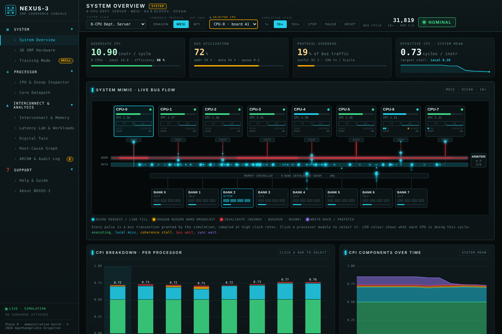
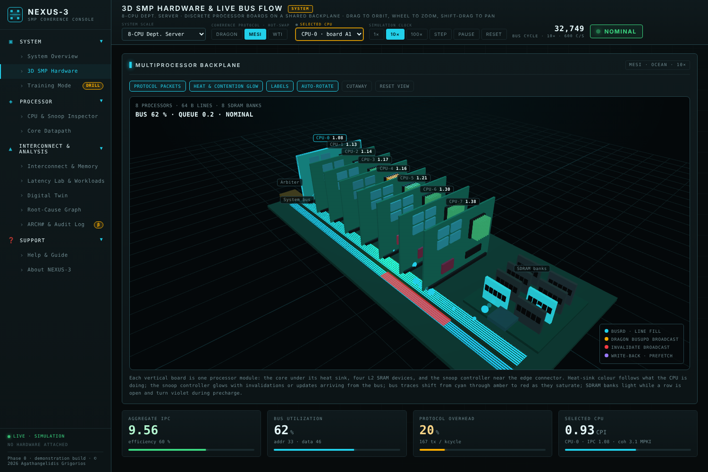
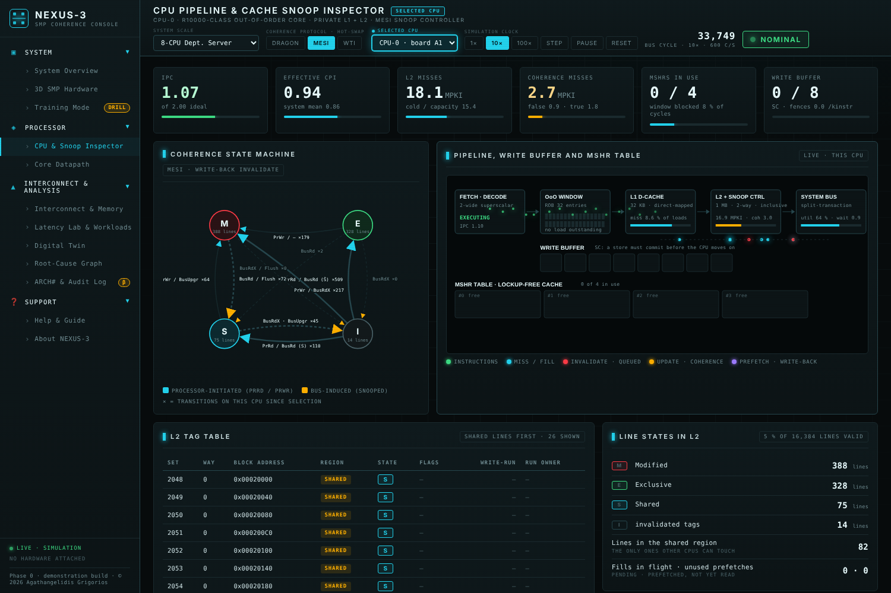
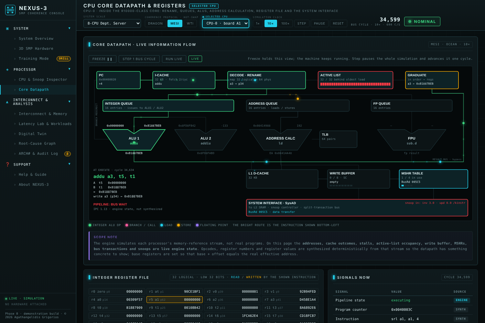
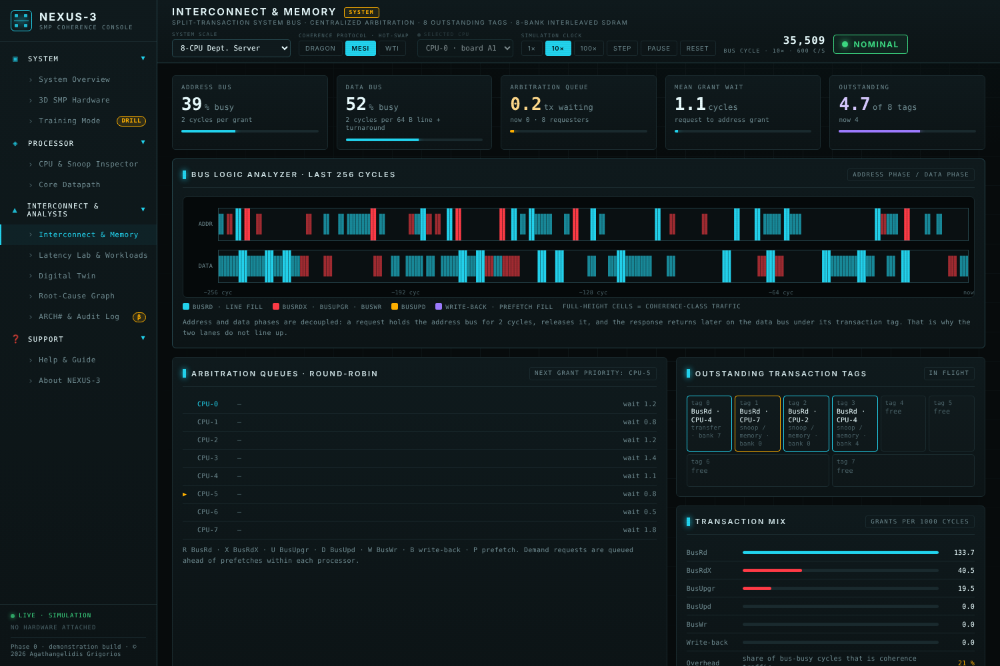
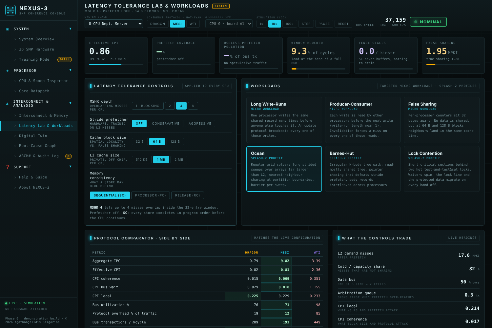
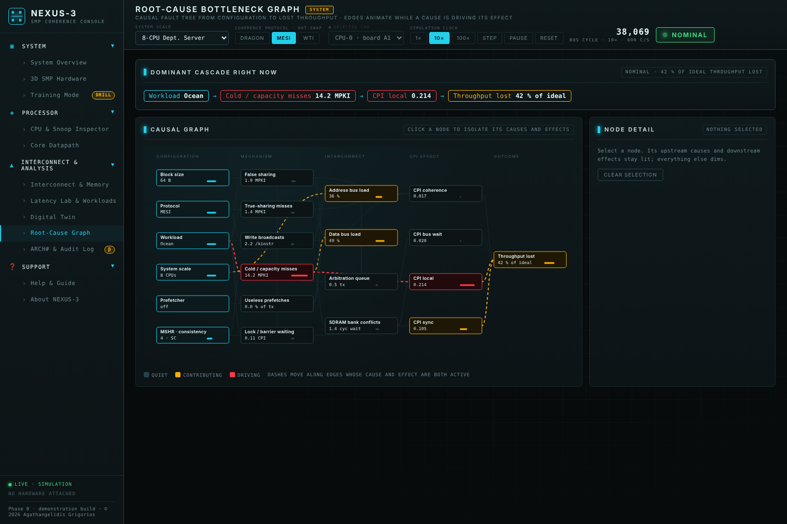
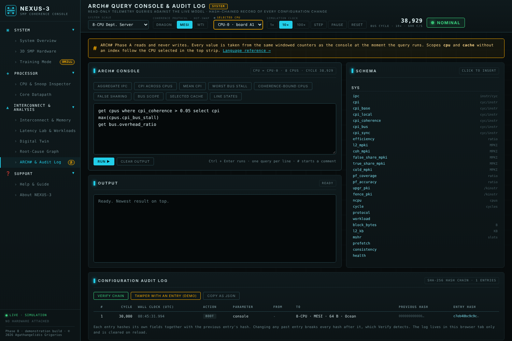

# NEXUS-3 — SMP Coherence & Latency Tolerance Console

**A single-file simulation console and digital twin for a bus-based symmetric multiprocessor.**

[](LICENSE)




NEXUS-3 runs entirely in the browser from one `index.html`. It simulates, cycle by cycle, a late-1990s shared-memory multiprocessor: 4 to 16 discrete processor boards with private L1 and L2 caches, a split-transaction system bus with a central arbiter, and interleaved SDRAM. Three cache-coherence protocols (Dragon, MESI and write-through invalidate) can be swapped while the machine runs. Every processor cycle is charged to one CPI bucket, so you can see where the time goes. There are 12 views, an interactive 3D backplane and a small read-only query language, **ARCH#**.

It follows the quantitative framework of Culler, Singh and Gupta, *Parallel Computer Architecture: A Hardware/Software Approach*, and is the sibling of [NEXUS-1](https://github.com/gregory82gr/nexus1) (nuclear plant, [live demo](https://gregory82gr.github.io/Nexus-1-phase-0)) and [NEXUS-2](https://github.com/gregory82gr/Nexus-2-phase-0) (satellite constellation). It reuses their design language.

> **Simulation only.** NEXUS-3 is a demonstration and study tool. It models a bus-based SMP of discrete boards, not a single-die multicore, a NUMA machine or any specific commercial system. Timing constants are generic and plausible for the era, not taken from a data sheet. The workloads are synthetic reference generators shaped after published program behaviour; they do not execute real programs. It is not a validated architecture simulator and not a performance-prediction tool.

---

## Quick start

1. Download `index.html`.
2. Open it in a current browser (Chrome, Edge, Firefox or Safari).

There is nothing to install or build, and no server is needed. Two optional external resources are loaded from CDNs:

| Resource | Used for | Without it |
|---|---|---|
| [three.js r128](https://threejs.org/) (cdnjs) | 3D backplane view | That view shows a fallback notice; every other view works |
| Google Fonts (Chakra Petch, IBM Plex Mono) | Typography | The browser substitutes system fonts |

### Publish it with GitHub Pages

1. Open **Settings → Pages**, choose **Deploy from a branch**, then select `main` and `/ (root)`.
2. The console is served at `https://<user>.github.io/<repository>/`.

---

## What's inside

### System
- **System Overview.** Aggregate IPC, bus utilization, protocol overhead, an animated system mimic with one pulse per bus transaction, and the stacked CPI breakdown per processor and over time.
- **3D SMP Hardware.** The backplane in three.js: processor boards with heat sinks, L2 SRAM and snoop controllers, the bus traces, the arbiter and the SDRAM banks. Components glow with live load; packets travel in protocol colours. Orbit, zoom, pan, hover for details, click a board to select it.
- **Training Mode.** Six scored drills that tick themselves off as you work anywhere in the console:
  - diagnose false sharing
  - stop a Dragon BusUpd flood
  - producer-consumer under invalidation
  - tune latency tolerance for Ocean
  - find the prefetch pollution
  - hide write latency with a weaker consistency model



### Processor (follows the top-bar selector)
- **CPU & Snoop Inspector.** The live state-transition diagram of the active protocol with transition counts, the pipeline with write buffer and MSHR table, and the L2 tag table with line states and write-run counters.
- **Core Datapath.** Inside the core: rename, queues, ALU 1 and ALU 2, address calculation, FPU, register file, D-cache, write buffer, MSHRs and the system interface, with each instruction travelling its route. Below it, the register file, a signal table and an instruction log. The view can be frozen while the machine keeps running, and any logged instruction can be replayed on the diagram.




### Interconnect & analysis
- **Interconnect & Memory.** A bus logic analyzer for the address and data phases, arbitration queues, outstanding transaction tags, the transaction mix, queuing delay against utilization, and the SDRAM banks.
- **Latency Lab & Workloads.** MSHR depth, stride prefetcher, block size, L2 size and memory consistency model, six workloads, and a comparator that runs all three protocols on the current configuration.
- **Digital Twin.** The textbook CPI prediction (blocking misses plus M/D/1 bus queueing) set against the simulation, component by component.
- **Root-Cause Graph.** A causal graph from configuration to lost throughput. Edges animate while a cause is driving its effect.
- **ARCH# & Audit Log.** See [below](#arch).





### Support
- **Help & Guide.** Four illustrated tabs: SMP versus multicore, a protocol atlas with timing charts, the anatomy of latency tolerance and overhead, and the ARCH# reference with console operations.
- **About.** Author, scope, the Phase 0 roadmap and a standards-awareness table.

---

## ARCH#

ARCH# is a small, deterministic, read-only query language over the live telemetry. There is no verb that changes the machine, and the parser rejects anything that looks like one.

```text
get sys.ipc                                    # one signal
get cpu[5].cpi_coherence                       # a specific processor
get cpus.cpi                                   # one value per processor
mean(cpus.cpi)
max(cpus.cpi_bus_stall)                        # also reports which CPU
get cpus where cpi_coherence > 1.2 select cpi  # filter
```

Scopes are `sys`, `bus`, `mem`, `cpu`, `cpu[k]`, `cache`, `cache[k]`, `cpus` and `caches`. Every configuration change made through the console is appended to a SHA-256 hash-chained audit log that can be verified on the same page.



---

## Models at a glance

| Domain | NEXUS-3 model | Main simplification |
|---|---|---|
| Processors | 2-wide out-of-order core, 32-entry window, 8-entry write buffer, 1 to 8 MSHRs | No branch misprediction; instruction cache not simulated |
| Caches | Private L1 and 2-way L2 with inclusion, 32/64/128 B blocks | L1 is a direct-mapped timing filter |
| Coherence | Dragon, MESI and WTI state machines, atomic in bus order | One bus; no MOESI or directory protocols |
| Bus | Split address and data phases, round-robin arbiter, 8 outstanding tags | Generic timing, one clock domain |
| Memory | 8 interleaved SDRAM banks with a bank cycle time | Uniform latency, no refresh |
| Latency tolerance | Lockup-free cache, stride prefetcher, SC/PC/RC write-buffer behaviour | Illustrative prefetch heuristics |
| Workloads | Long write-runs, producer-consumer, false sharing, Ocean, Barnes-Hut, lock contention | Synthetic generators, not SPLASH-2 runs |
| Core datapath | Live addresses, cache outcomes, stalls and bus activity | Opcodes and register values are synthesized from the reference stream |

---

## Project structure

```text
index.html     the whole application: HTML, CSS and JavaScript in one file
docs/          screenshots used in this README
LICENSE        MIT License
README.md      this file
```

The engine is one object, `window.NEXUS3.eng`. One simulation cycle is one bus clock. The workload generators are seeded, so a configuration replays the same reference stream after every reset.

---

## Author

**Grigorios Agathangelidis** — software engineer and author of the NEXUS book series on Domain-Driven Design and formal methods ([Leanpub](https://leanpub.com/u/grigorios-kyriakos-agathangelidis)).

## Acknowledgements

- [three.js](https://threejs.org/) (MIT License) for the 3D view.
- [Chakra Petch](https://fonts.google.com/specimen/Chakra+Petch) and [IBM Plex Mono](https://fonts.google.com/specimen/IBM+Plex+Mono) (SIL Open Font License).
- D. E. Culler, J. P. Singh and A. Gupta, *Parallel Computer Architecture: A Hardware/Software Approach*, for the framework this console follows.

NEXUS-3 is an independent project. It is not affiliated with, endorsed by or connected to any processor or system vendor. MIPS, UltraSPARC, SGI and Sun names appear only as historical points of reference.

## License

Released under the [MIT License](LICENSE). Copyright © 2026 Grigorios Agathangelidis.
